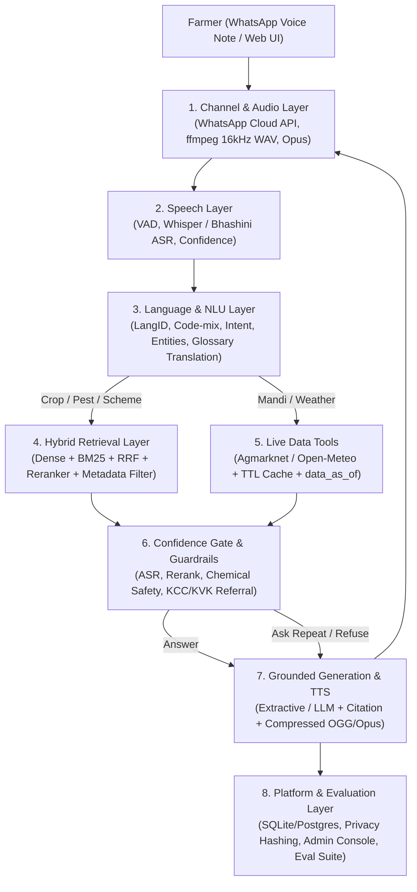
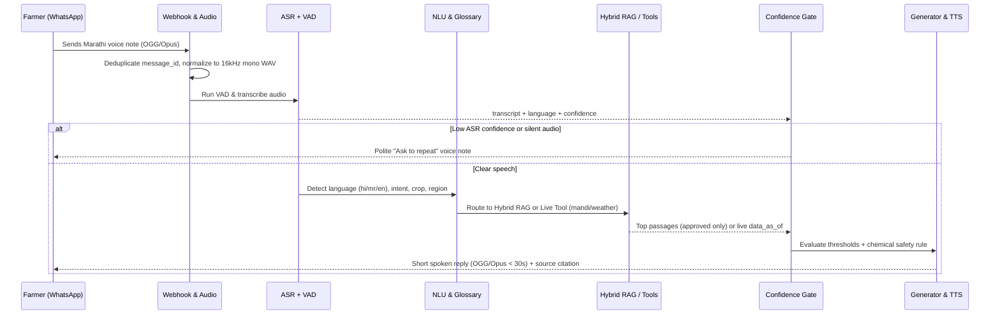

# System Architecture — AgriAssistant

AgriAssistant is a voice-first, multilingual agricultural assistant built for Indian smallholder farmers, FPOs, and extension workers. It accepts spoken or text queries in **Marathi (`mr`)**, **Hindi (`hi`)**, **English (`en`)**, and code-mixed speech, retrieves grounded evidence from verified agricultural bulletins or live data tools, and replies with a short, cited voice note over WhatsApp or the web console.

## 1. Layered Architecture

## 2. End-to-End Request Flow

## 3. Module Inventory (14 Modules)

| # | Module | Implementation |
|---|---|---|
| 1 | Channel & Audio Interface | [whatsapp.py](file:///Users/kirannandi/Projects/AgriAssistant/app/channels/whatsapp.py), [processor.py](file:///Users/kirannandi/Projects/AgriAssistant/app/audio/processor.py) |
| 2 | Speech-to-Text (ASR) | [asr.py](file:///Users/kirannandi/Projects/AgriAssistant/app/speech/asr.py) |
| 3 | LangID, Intent & Entities | [query_understanding.py](file:///Users/kirannandi/Projects/AgriAssistant/app/nlp/query_understanding.py) |
| 4 | Glossary-Protected Translation | [translation.py](file:///Users/kirannandi/Projects/AgriAssistant/app/nlp/translation.py) |
| 5 | Knowledge Ingestion & Versioning | [cleaner.py](file:///Users/kirannandi/Projects/AgriAssistant/app/knowledge/cleaner.py), [ingestor.py](file:///Users/kirannandi/Projects/AgriAssistant/app/knowledge/ingestor.py) |
| 6 | Embeddings & Vector Store | [embeddings.py](file:///Users/kirannandi/Projects/AgriAssistant/app/retrieval/embeddings.py), [vector_store.py](file:///Users/kirannandi/Projects/AgriAssistant/app/retrieval/vector_store.py) |
| 7 | Hybrid Retrieval & Reranker | [bm25.py](file:///Users/kirannandi/Projects/AgriAssistant/app/retrieval/bm25.py), [hybrid.py](file:///Users/kirannandi/Projects/AgriAssistant/app/retrieval/hybrid.py) |
| 8 | Live Data Tools (Mandi & Weather) | [mandi.py](file:///Users/kirannandi/Projects/AgriAssistant/app/tools/mandi.py), [weather.py](file:///Users/kirannandi/Projects/AgriAssistant/app/tools/weather.py) |
| 9 | Grounded Answer Generation | [generator.py](file:///Users/kirannandi/Projects/AgriAssistant/app/generation/generator.py) |
| 10 | Confidence Gate & Fallback | [confidence_gate.py](file:///Users/kirannandi/Projects/AgriAssistant/app/safety/confidence_gate.py) |
| 11 | TTS & Low-Bandwidth Delivery | [tts.py](file:///Users/kirannandi/Projects/AgriAssistant/app/speech/tts.py) |
| 12 | Safety, Privacy & Compliance | [guardrails.py](file:///Users/kirannandi/Projects/AgriAssistant/app/safety/guardrails.py), [privacy.py](file:///Users/kirannandi/Projects/AgriAssistant/app/db/privacy.py) |
| 13 | Evaluation & Monitoring | [metrics.py](file:///Users/kirannandi/Projects/AgriAssistant/app/eval/metrics.py), [runner.py](file:///Users/kirannandi/Projects/AgriAssistant/app/eval/runner.py) |
| 14 | Admin Console & Expert Review | [admin.py](file:///Users/kirannandi/Projects/AgriAssistant/app/api/admin.py), `frontend/` |
